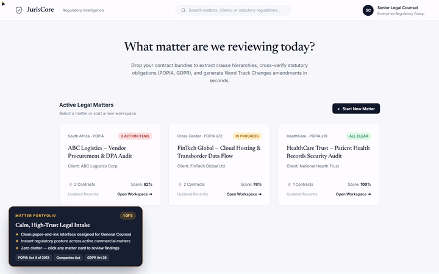
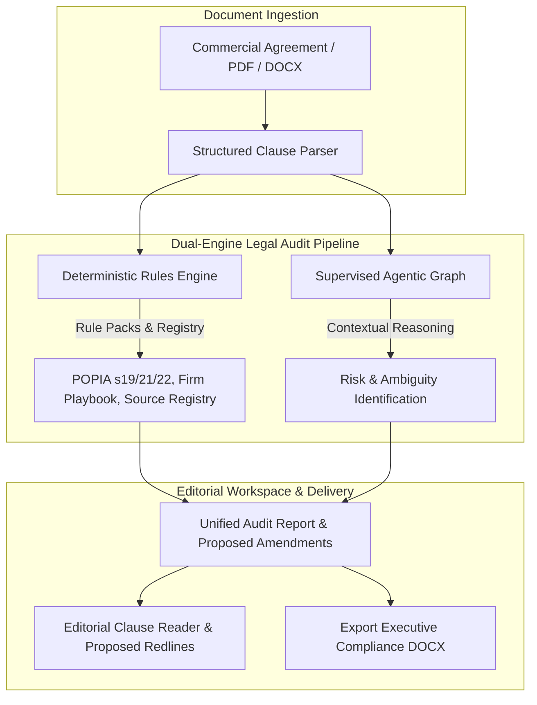

# JurisCore
### Supervised Agentic AI Graph & Deterministic Legal Compliance Engine

---

> ### 🔒 Data Privacy & Verification Notice
> **Proprietary Codebase:** The complete source codebase for this project is hosted in a private repository to maintain local system sovereignty, protect proprietary legal prompt engineering, and safeguard client legal analysis workflows.
> 
> **Live Verification:** This repository serves as the public system architecture map and technical documentation. I am highly comfortable performing a live, end-to-end system demonstration and code walk-through during an interview to verify all architectural implementations and logic flows.

---

## 🎥 System Walkthrough & Interactive Demo

  
  
<em>Click the preview above or <a href="media/juriscore_walkthrough.mp4">click here to watch the full HD video walkthrough (MP4)</a>.</em>

---

## 🏛️ Executive Summary

**JurisCore** is a specialized legal technology application combining deterministic statutory rules engines with supervised agentic AI workflows. Engineered specifically for corporate commercial law and regulatory audit in the South African jurisdiction, it bridges the gap between deep statutory analysis and clean, readable legal user experiences.

It empowers legal teams to audit commercial agreements, generate proposed contract amendments, detect statutory compliance gaps (such as POPIA operator obligations, security measures, and breach-notification SLAs), and explore contracts through a distraction-free editorial interface.

---

## 🧠 System Architecture & Workflow

JurisCore separates non-deterministic AI inference from deterministic statutory verification rules:

---

## ⚖️ Statutory Compliance & Playbook Rules

JurisCore comes pre-loaded with deterministic rule packs and a statutory source registry:

1. **`POPIA_DEFAULT_v1` (POPIA Sections 19, 21 & 22):** Audits Operator confidentiality and authorisation obligations (s21), technical and organisational security measures (s19), breach-notification SLAs (s22), and statutory citations.
2. **`FIRM_PLAYBOOK_v1` (Commercial Contracting Playbook):** Enforces a 12-month-fees Limitation of Liability cap, flags prohibited unlimited indemnity language, enforces a stricter 24-hour vendor breach-notification SLA, and supports adding custom playbook rules via API.
3. **`LegalSourceRegistry`:** Validates statutory citations against registered entries covering POPIA (s19, s21, s22), Companies Act 71 of 2008 (s66), and GDPR (Article 28).
4. **Proposed Amendments & DOCX Export:** Generates surgical proposed clause amendments with legal basis commentary and exports executive compliance reports in HTML, JSON, and WordprocessingML `.docx` formats.

---

## ✨ Interface & Editorial Design

JurisCore departs from cluttered multi-chart dashboards in favor of an **editorial, typography-first legal workspace**:
- **Editorial Paper Light Mode:** Clean, serif and clean sans typography calibrated for prolonged document review.
- **Distraction-Free Clause Reader:** Side-by-side comparative viewing of original clauses alongside AI-assisted redlines and statutory risk scores.
- **Instant Filtering:** Filter clauses by risk severity (High, Medium, Low), statutory category, or review status.

---

## 🛠️ Technology Stack & Engine Specs

- **Backend:** Python 3.11+, FastAPI asynchronous REST endpoints.
- **Frontend:** Modern responsive web interface, customized light/dark typography-first layout.
- **LLM Orchestration:** Supervised agentic graph with structured Pydantic schema validation.
- **Document Processing:** Streamlined DOCX/PDF text extraction and reconstruction.

---

---

## 🔗 Portfolio & Technical Dossier

- **Live System Overview:** [sandisomazibuko.com/technology/#juriscore](https://sandisomazibuko.com/technology/#juriscore)
- **Statutory Audit Dossier:** [JurisCore Statutory Audit Report](https://sandisomazibuko.com/documents/juriscore-statutory-audit-report/)
- **Canonical Portfolio:** [Sandiso Mazibuko](https://sandisomazibuko.com/) · [hello@sandisomazibuko.com](mailto:hello@sandisomazibuko.com)

Architected and maintained by **[Sandiso Mazibuko](https://sandisomazibuko.com/)**.
