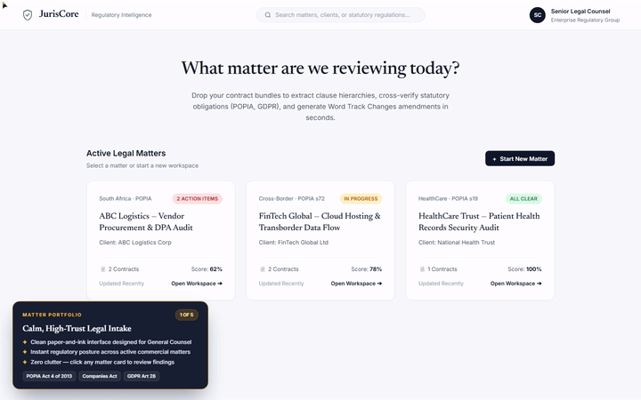
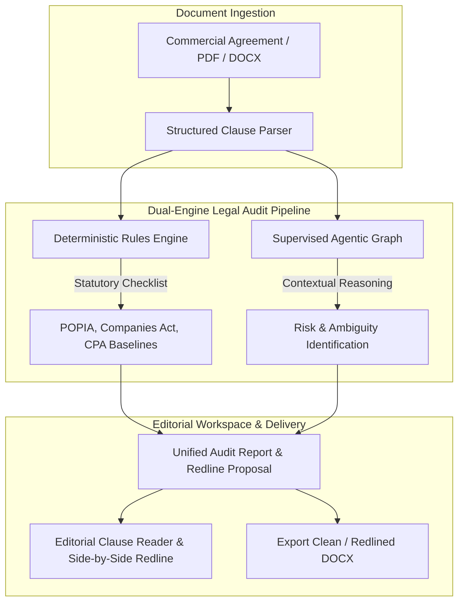

# JurisCore
### Supervised Agentic AI Graph & Deterministic Legal Compliance Engine

---

> ### 🔒 Data Privacy & Verification Notice
> **Proprietary Codebase:** The complete source codebase for this project is hosted in a private repository to maintain local system sovereignty, protect proprietary legal prompt engineering, and safeguard client legal analysis workflows.
> 
> **Live Verification:** This repository serves as the public system architecture map and technical documentation. I am highly comfortable performing a live, end-to-end system demonstration and code walk-through during an interview to verify all architectural implementations and logic flows.

---

## 🎥 System Walkthrough & Interactive Demo

  
  
<em>Click the preview above or <a href="media/juriscore_walkthrough.mp4">click here to watch the full HD video walkthrough (MP4)</a>.</em>

---

## 🏛️ Executive Summary

**JurisCore** is a specialized legal technology application combining deterministic statutory rules engines with supervised agentic AI workflows. Engineered specifically for corporate commercial law and regulatory audit in the South African jurisdiction, it bridges the gap between deep statutory analysis and clean, readable legal user experiences.

It empowers legal teams to audit complex commercial agreements, redline non-compliant terms, detect statutory compliance gaps (such as POPIA data processing terms and Companies Act director indemnities), and explore contracts through an distraction-free editorial interface.

---

## 🧠 System Architecture & Workflow

JurisCore separates non-deterministic AI inference from deterministic statutory verification rules:

---

## ⚖️ Statutory Compliance & Playbook Rules

JurisCore comes pre-loaded with commercial playbook rules mapped directly to South African statutes and common law standards:

1. **POPIA Section 19 & 21 Compliance:** Audits Operator and Responsible Party obligations, mandatory breach notification windows, and cross-border data transfer limitations.
2. **Companies Act 71 of 2008:** Scans director indemnification clauses against Section 78 restrictions to detect prohibited liability waivers.
3. **Consumer Protection Act (CPA) Section 48 & 49:** Identifies unfair, unreasonable, or unjust contract terms and mandatory notice requirements for indemnity risks.
4. **Commercial Risk Redlining:** Automatically proposes surgical redline amendments with statutory citations and lawyer-ready commentary.

---

## ✨ Interface & Editorial Design

JurisCore departs from cluttered multi-chart dashboards in favor of an **editorial, typography-first legal workspace**:
- **Editorial Paper Light Mode:** Clean, serif and clean sans typography calibrated for prolonged document review.
- **Distraction-Free Clause Reader:** Side-by-side comparative viewing of original clauses alongside AI-assisted redlines and statutory risk scores.
- **Instant Filtering:** Filter clauses by risk severity (High, Medium, Low), statutory category, or review status.

---

## 🛠️ Technology Stack & Engine Specs

- **Backend:** Python 3.11+, FastAPI asynchronous REST endpoints.
- **Frontend:** Modern responsive web interface, customized light/dark typography-first layout.
- **LLM Orchestration:** Supervised agentic graph with structured Pydantic schema validation.
- **Document Processing:** Streamlined DOCX/PDF text extraction and reconstruction.

---

Architected and maintained by **Sandiso Mazibuko**.
